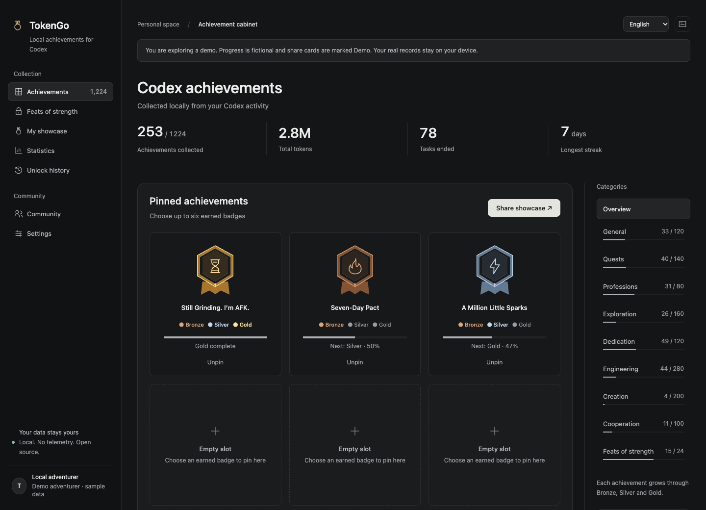
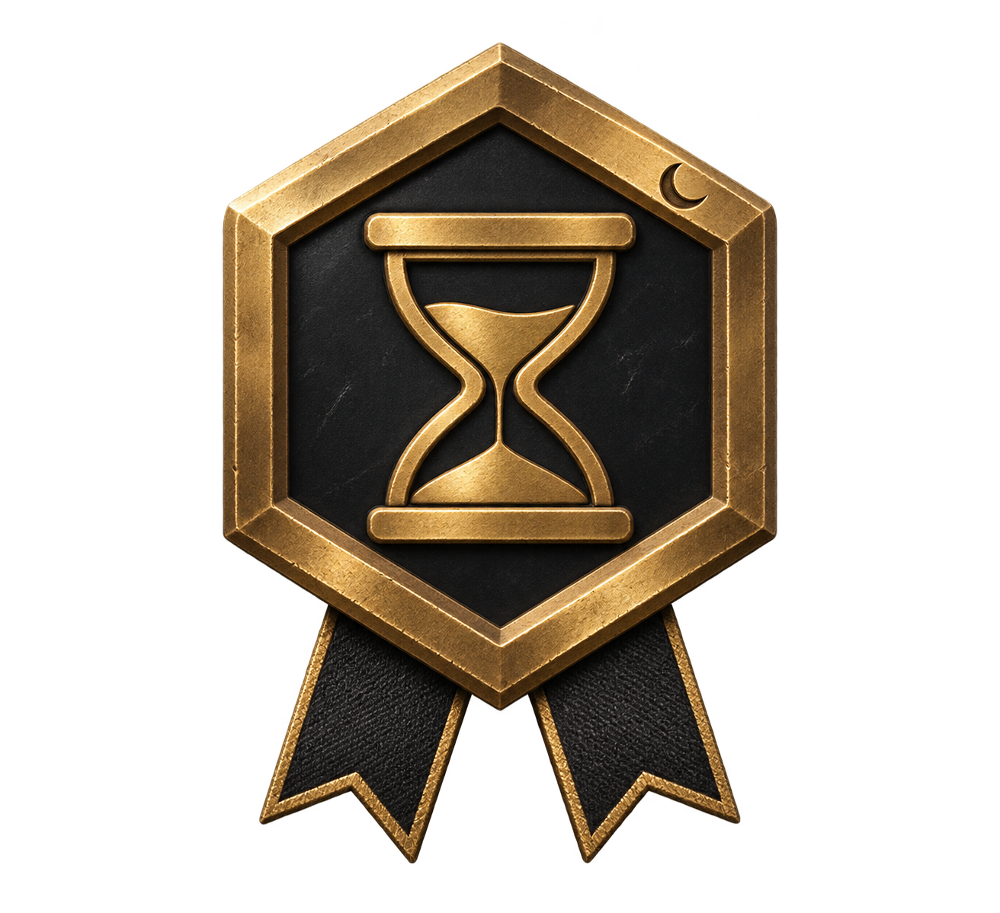
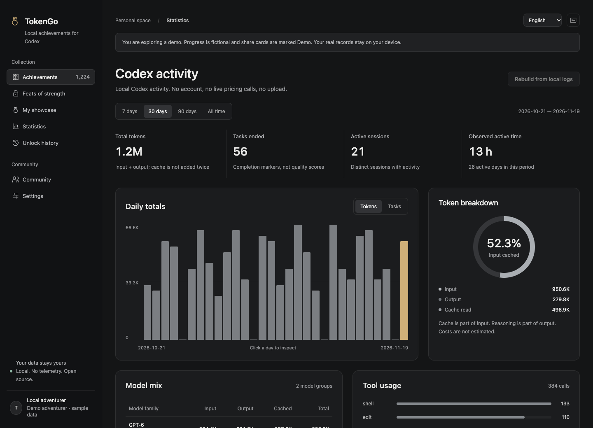

<div align="center">


# TokenGo

### Your agent does the work. You collect the stories.

A local achievement cabinet for Codex.<br />Hidden discoveries, three medal tiers, and little moments worth sharing.

**1,224 achievements · 8 languages · No hosted backend**

[**Get TokenGo ↓**](#start-collecting) &nbsp; / &nbsp; [Explore the preview ↗](https://dragonyj.github.io/TokenGo/) &nbsp; / &nbsp; [Create an achievement ↗](CONTRIBUTING.md)

<sub>Open source · MIT · Built by <a href="https://github.com/DragonYJ">DragonYJ</a></sub>

</div>

<br />

## A little reward for the work you were already doing

Your first completed task. A week of showing up. An agent that is still working long after you stepped away.

TokenGo turns observable Codex activity into a collection. It reads local logs, unlocks medals, and celebrates with a compact card in the bottom-right corner. No focus stealing. No account to create. No upload required.

<div align="center">

<br />
<sub>A short entrance. A medal landing. Then back to work.</sub>
</div>

<br />

<table>
<tr>
<td width="33%" valign="top">

### Collect

**Bronze → Silver → Gold**

Milestones for tasks, tokens, tools and active runs. Hidden achievements keep their names and conditions secret until you earn them.

</td>
<td width="33%" valign="top">

### Curate

**Six slots. Your favorites.**

Pin the medals that matter to you. Track your next tier and browse one domain at a time, instead of scrolling through thousands of badges.

</td>
<td width="33%" valign="top">

### Share

**X. Reddit. Anywhere.**

Make a PNG and caption locally. Choose where it goes, attach the image, and publish it yourself. Cards point friends back to TokenGo.

</td>
</tr>
</table>

## A cabinet, not another task list



Explore **General · Quests · Professions · Exploration · Dedication · Engineering · Creation · Cooperation · Feats of strength**.

The collection contains **60 metric families × 20 milestone badges, plus 24 hidden discoveries**. Each achievement has three medal tiers. The 1,224 count includes milestone thresholds; it does not mean 1,224 different behaviors.

<details>
<summary><strong>Inside the artwork: Still Grinding. I’m AFK.</strong></summary>

<br />
<div align="center">

</div>

Machined brass, black enamel, and a small crescent for the overnight shift. This is new collectible artwork; the running interface currently uses lightweight SVG badges. The header medals are decorative illustrations, not a record of anyone's achievements.

[Artwork files and generation prompts](assets/artwork/README.md)

</details>

## See the work behind the medals



Daily trends, input/output/cache tokens, model families, tool categories, hourly activity and a session explorer—all computed from available local records. No billing credentials or external pricing calls.

**English · Chinese · Japanese · Korean · Spanish · French · German · Portuguese**

The interface, built-in achievement names, notifications and share copy use bundled offline translations. English is the default.

## Start collecting

### Ask Codex

> Install TokenGo from https://github.com/DragonYJ/TokenGo using its README. Enable local achievement collection whenever Codex is open on macOS, and set up its sidebar plugin. Keep my records on this computer.

### Or use your terminal

Requires **Node.js 22.12+**, Git, a graphical desktop session, and a Codex client with plugin support.

```sh
npm install --global github:DragonYJ/TokenGo
tokengo connect
```

On **macOS**, setup prepares the local notification runtime and a user-level service. Collection follows Codex silently, without a cabinet window or Dock icon. Quit Codex and collection stops, normally within five seconds; a small observer waits for the next launch.

On **Windows and Linux**, automatic following is not implemented yet. Start collection manually:

```sh
tokengo start --collect
```

**Sidebar integration is still being verified in the desktop client.** The local MCP plugin, embedded cabinet and notification deep links pass integration tests. CLI installation alone does not confirm that your client has displayed the entry. Fully quit and reopen the client, then check the Plugins Directory's local marketplace source. See [sidebar setup and missing-entry troubleshooting](docs/INSTALL.md#sidebar-plugin). Until the embedded cabinet connects successfully, notification clicks open the local companion cabinet.

Installation downloads need the internet. **Collecting, unlocking, viewing statistics and making cards work offline.** No installer wizard is required; a local background process still powers collection and native notifications.

[Full installation guide](docs/INSTALL.md) · [Metric definitions](docs/METRICS.md) · [Security model](SECURITY.md)

<details>
<summary><strong>Useful commands, updates and removal</strong></summary>

```sh
tokengo open          # Open the local cabinet
tokengo status        # Inspect the macOS follow service
tokengo disable       # Stop automatic following
tokengo enable        # Enable macOS following again
```

Without a global command:

```sh
npx --yes --package=github:DragonYJ/TokenGo tokengo connect
```

The npx option uses npm's cache. A global installation is more durable; clearing the cache requires setup again.

Before updating, disable following and quit TokenGo. Repeat the installation command, then run `tokengo connect` to refresh the plugin and collector.

Before uninstalling, run `tokengo disconnect` while the collector is running, then `tokengo disable` and quit TokenGo. Remove the command with `npm uninstall --global tokengo`. Your records are preserved.

[Standalone desktop downloads](https://github.com/DragonYJ/TokenGo/releases/latest) remain an alternative. Community builds are unsigned, include SHA-256 manifests, and have no automatic updater.

</details>

## Private by default. Shared by choice.

| Stays on your device | Leaves only when you choose |
| :--- | :--- |
| Local Codex activity processing | A card you save and publish |
| Achievement progress and evidence | A caption you copy into a post |
| Statistics and generated PNGs | An optional community contribution |

No telemetry, analytics SDK, remote fonts, API keys or background upload. Conversation text, code, command arguments and raw project paths are not retained. Counts, salted identifiers and local evidence drive the achievements. The collector reads local Codex rollout files; the renderer blocks outbound requests.

TokenGo never publishes a social post for you. X and Reddit image attachment is manual.

<details>
<summary><strong>Preview a share card</strong></summary>


The public website and these screenshots use fictional examples. Their cards retain the **Demo** marker. Real local achievements do not use that marker.

</details>

<details>
<summary><strong>Community rarity without pretending to know the whole world</strong></summary>

Unlock rates describe **voluntary community contributors**, with the sample size shown. They are not global rates. Until real reports exist, the interface says **No community sample yet**.

Contributions contain a random participant ID and earned achievement IDs with medal levels. You preview the payload, acknowledge the disclosure, and submit it in a GitHub issue yourself. **The issue and your GitHub account are public; the submission is not identity-anonymous.** Nothing is contributed automatically.

Maintainers approve reports and GitHub Actions publishes aggregates. TokenGo bundles a snapshot; importing an updated snapshot is explicit. No paid server or automatic exchange is required.

[Read the community protocol](docs/COMMUNITY.md)

</details>

<details>
<summary><strong>What local achievements can—and cannot—prove</strong></summary>

Deduplication prevents replaying the same events. HMAC-protected state and a hash-linked evidence journal detect basic edits. A person who controls the computer can still forge records. Local achievements and self-reported community samples are not certified competitive rankings.

A task-ended marker does not prove correct work; a tool call does not prove successful output. An active run is observed within one task, with no more than five minutes between events. Idle gaps and task endings break it. Missing logs, long silent reasoning and skipped forked sessions can lead to undercounting.

The adapter reads uncompressed `.jsonl` files in Codex's `sessions` and `archived_sessions` directories. Forked rollout replay is conservatively skipped. Statistics are not a complete billing ledger; costs are not estimated. Token milestones are not a reason to waste tokens or miss sleep.

[Metric definitions](docs/METRICS.md) · [Security boundaries](SECURITY.md)

</details>

## Make someone's next unexpected unlock

A good achievement starts with a memorable name and an observable rule.

- **Design a milestone or secret.** Add a declarative JSON pack in `packs/`.
- **Bring another language.** Follow the [localization guide](docs/LOCALIZATION.md).
- **Make a new cabinet or card.** Use the [artwork kit](assets/artwork/README.md), or create your own.
- **Build on the records.** Create local adapters or opt-in extensions with their own consent and trust models.

[**Contribute an achievement →**](CONTRIBUTING.md) &nbsp; [Discuss an idea →](https://github.com/DragonYJ/TokenGo/issues)

<details>
<summary><strong>Build and develop locally</strong></summary>

```sh
git clone https://github.com/DragonYJ/TokenGo.git
cd TokenGo
npm ci
npm start
```

```sh
npm run demo           # Fictional preview; never scans your logs
npm test               # Rules, deduplication, migration and privacy
npm run validate       # Validate achievement packs
npm run test:ui        # Browser, PNG cards and responsive layout
npm run test:desktop   # Native flow with synthetic logs
npm run build:plugin   # Bundle the offline MCP sidebar plugin
npm run test:mcp       # MCP, embedded UI and deep-link integration
npm run build          # Package for the current operating system
npm run site           # Build the static preview in dist/site
```

The headless core needs only Node.js built-ins:

```sh
node src/cli.mjs scan
node src/cli.mjs watch
```

`CODEX_HOME` selects the log directory (default `~/.codex`); `TOKENGO_HOME` selects the record directory. Desktop and headless CLI use different defaults. Do not run two writers against the same record directory.

```text
src/core/       Rules, local adapter, collection and statistics
src/desktop/    Native notifications and isolated IPC
src/mcp/        Local MCP server and embedded cabinet bridge
src/ui/         Cabinet, statistics, translations and cards
packs/          Declarative achievements
assets/artwork/ Collectible illustrations and art direction
community/      Aggregate sample data
```

GitHub Releases, Pages and Actions provide distribution, the public preview and voluntary sample aggregation. TokenGo needs no hosted backend.

</details>

---

<div align="center">

**Keep the work local. Take the medals with you.**

[Install](#start-collecting) · [Explore](https://dragonyj.github.io/TokenGo/) · [Contribute](CONTRIBUTING.md) · [MIT License](LICENSE)

<sub>Created by <a href="https://github.com/DragonYJ">DragonYJ</a>.</sub>

</div>

<sub>Independent project; not affiliated with OpenAI, Valve or Blizzard. TokenGo reads local Codex records, not ChatGPT web conversations. Unlock interactions draw inspiration from Steam, category organization from World of Warcraft, and statistics organization from [token-tracker](https://github.com/pepperonas/token-tracker). Interface refinement follows [Unslop by Damir Sokolovsky](https://github.com/heydamir/unslop), licensed under CC BY 4.0; see [design decisions](docs/DESIGN.md). The collectible raster illustrations were generated with an image-generation tool; their prompts are included in the artwork kit.</sub>
