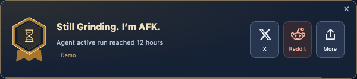
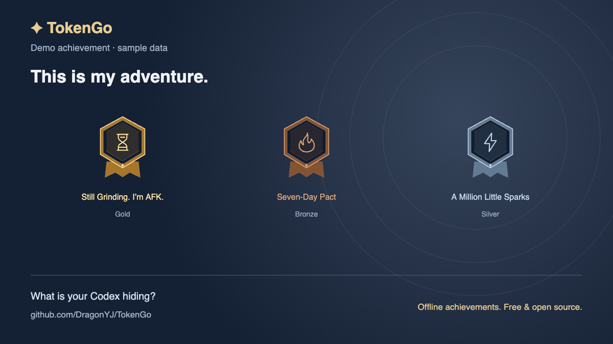

<div align="center">

# ✦ TokenGo

### Your agent grinds. You collect.

**Turn everyday Codex work into a trophy room full of unexpected moments.**

[Try the demo](https://dragonyj.github.io/TokenGo/) · [Download TokenGo](https://github.com/DragonYJ/TokenGo/releases/latest) · [Invent an achievement](CONTRIBUTING.md)

Offline collection. Hidden discoveries. No account. Free & open source.

</div>


You came to ship a feature. Your agent disappeared into a twelve-hour quest. Somewhere along the way, a little card appeared:



**That is TokenGo.** A local desktop companion for Codex, with the delight of a Steam unlock and a WoW-inspired achievement cabinet. Keep doing your work. Let the surprises find you.

## A lot to discover. A little to show off.

- **1,224 achievements, three medals each.** 60 metric families × 20 milestone badges, plus 24 hidden discoveries. Every badge grows through **Bronze → Silver → Gold**. This count includes milestone thresholds, not 1,224 distinct behaviors.
- **A trophy room that feels yours.** Pin six favorite achievements, see the next medal's progress, and explore domains from the right-hand navigation. No wall of a thousand badges.
- **Tiny interruptions, big aha moments.** Bottom-right cards never take keyboard focus. Hover to pause. Click the card to return to your cabinet. Quiet mode is built in.
- **Three ways to share.** Prominent X, Reddit and Other buttons lead to your next step. Generate a PNG and caption locally; you attach the image and publish the post yourself. Every card points back to TokenGo.
- **Statistics with a story.** Daily trends, input/output/cache breakdowns, model families, tool categories, hourly activity and a session explorer. No billing credentials or external pricing calls.
- **English by default, multilingual by design.** English and Simplified Chinese are included. Translations live in a small, editable dictionary.
- **A community you can build on.** Add a JSON achievement pack, translate the interface, design a cabinet, or build your own extension. MIT licensed.


## Start your collection

1. **[Download the latest release](https://github.com/DragonYJ/TokenGo/releases/latest)** for macOS, Windows or Linux.
2. Open TokenGo and choose **Start collecting**, or scan your history in Settings. Nothing is scanned until you ask.
3. Work with Codex. Discover a badge. Pin it. Share the moment when you feel like it.

The website is a fictional demo, clearly labeled on screen and in exported cards. Install the desktop app to collect your own achievements. TokenGo is an independent companion, not an official OpenAI extension or a reader of ChatGPT web conversations.

Community builds are currently unsigned. Your OS may require explicit approval to open them; inspect the source or build locally if preferred. Release assets include SHA-256 manifests. There is no automatic updater.

### Run from source

Requires Node.js 22.12 or newer.

```sh
git clone https://github.com/DragonYJ/TokenGo.git
cd TokenGo
npm ci
npm start
```

```sh
npm run demo           # Fictional gallery; never scans your logs
npm test               # Rules, deduplication, migration, privacy and sample validation
npm run validate       # Validate every achievement pack
npm run test:ui        # Browser interactions, PNG cards and responsive layout
npm run test:desktop   # Native Electron flow using synthetic logs
npm run build          # Package for your current operating system
npm run site           # Build the static demo in dist/site
```

For a headless collector, the core needs only Node.js built-ins:

```sh
node src/cli.mjs scan
node src/cli.mjs watch
```

Downloads and dependency installation need the internet. **Collecting, unlocking and making cards do not.** The desktop companion stays in the tray when its window closes; choose Quit to stop it. `CODEX_HOME` selects your Codex data directory (default `~/.codex`). `TOKENGO_HOME` selects the record directory. Desktop and CLI use separate defaults; do not run two writers against the same directory.

## Your records stay yours

No telemetry. No analytics SDK. No remote fonts. No API keys. No background upload. The renderer blocks outbound requests, and the collector reads only local Codex rollout files. Conversation text, code, command arguments and raw project paths are not retained. Counts, salted identifiers and local evidence drive the achievements.

Sharing is always deliberate: preview your card, copy or save it, open the platform composer, and publish it yourself. TokenGo never posts on your behalf. X and Reddit image attachment is manual.



### Community unlock rates — optional, honest, serverless

Want to know how unusual a badge is? TokenGo supports **unlock rates among voluntary community contributors**, with the sample size shown. These are **not global rates**. Until real reports exist, the app says **No community sample yet**.

A contribution contains only a random participant ID and earned achievement IDs with their medal levels. Preview it locally, explicitly acknowledge the disclosure, then copy it into a GitHub issue yourself. **Your GitHub account and the report are public. The payload omits personal fields; the submission is not identity-anonymous.** No contribution happens automatically.

Maintainers approve reports; GitHub Actions publishes aggregate counts. The app bundles a snapshot, or you can explicitly import a newer `community/rates.json` file. No paid server and no automatic data exchange. See the [community protocol](docs/COMMUNITY.md).

### Honest achievements, honest limits

Deduplication prevents replaying the same events. HMAC-protected state and a hash-linked evidence journal detect basic edits. **A user who controls the computer can still forge records.** These are local achievements, not official certification, and community reports are self-reported. They cannot provide a cheat-proof competitive leaderboard.

A task-ended marker does not prove correct work. Tool calls do not prove successful output. An active run is observed within one task, with no more than five minutes between events; idle gaps and task endings break it. Missing logs, long silent reasoning and skipped forked sessions can lead to undercounting. Token milestones celebrate your history; they are not a reason to waste tokens or miss sleep.

Current ingestion supports uncompressed `.jsonl` files in Codex's `sessions` and `archived_sessions` directories. Forked rollout replay is conservatively skipped. Costs are not estimated. Statistics reflect available local records, not a complete billing ledger. See [metric definitions](docs/METRICS.md) and [security boundaries](SECURITY.md).

## Make the next unexpected achievement

The best easter egg might be yours. A funny name, an observable moment, a tiny JSON rule — that is enough to start.

- Add a milestone or a secret in `packs/`.
- Add a language in `src/ui/locales.js` and `src/ui/i18n.js`.
- Build a new cabinet, card style, local adapter or opt-in extension.
- Share an idea or submit a PR using the [contribution guide](CONTRIBUTING.md).

The core, desktop host and UI are separate. Cabinets, dashboards and independently hosted leaderboards can build on the exported records, with their own explicit consent and trust model. TokenGo itself needs no hosted backend: **GitHub Releases + GitHub Pages + GitHub Actions** handle distribution, the demo and voluntary sample aggregation.

```text
src/core/       Local rules, Codex adapter, collector and statistics
src/desktop/    Electron host, isolated IPC and native unlock window
src/ui/         Cabinet, statistics, localization and canvas cards
packs/          Declarative achievement packs
community/      Published aggregate sample, never individual reports
scripts/        Validation, demo build, release and interaction checks
```

Built by **dragony** and contributors. [MIT licensed](LICENSE).

The unlock interaction takes inspiration from Steam; domain organization from World of Warcraft; statistics organization from [pepperonas/token-tracker](https://github.com/pepperonas/token-tracker). Implementation and included vector artwork are original. TokenGo is not affiliated with Valve, Blizzard, OpenAI, or token-tracker.
